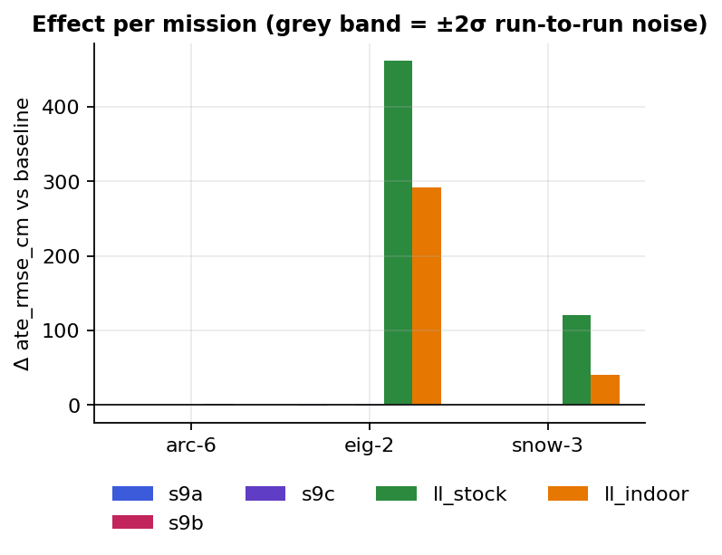
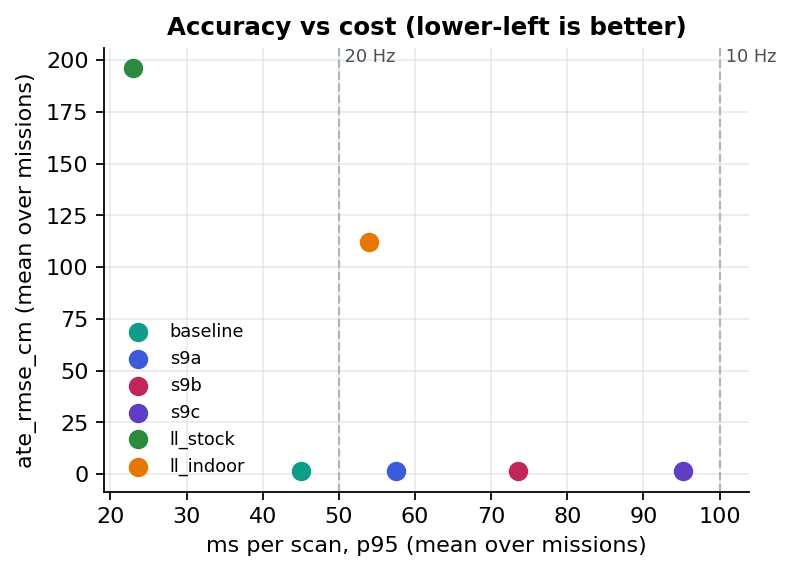
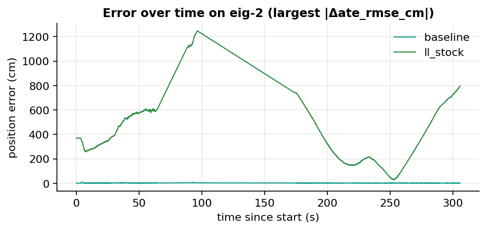
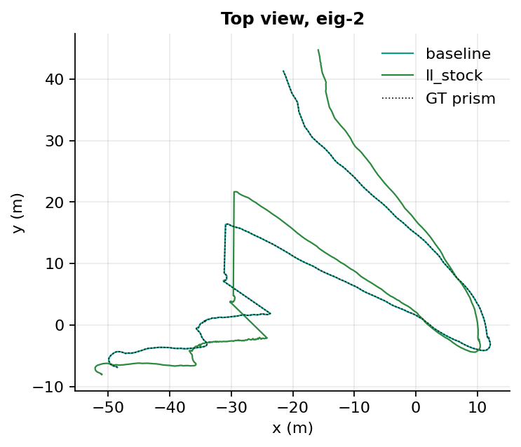
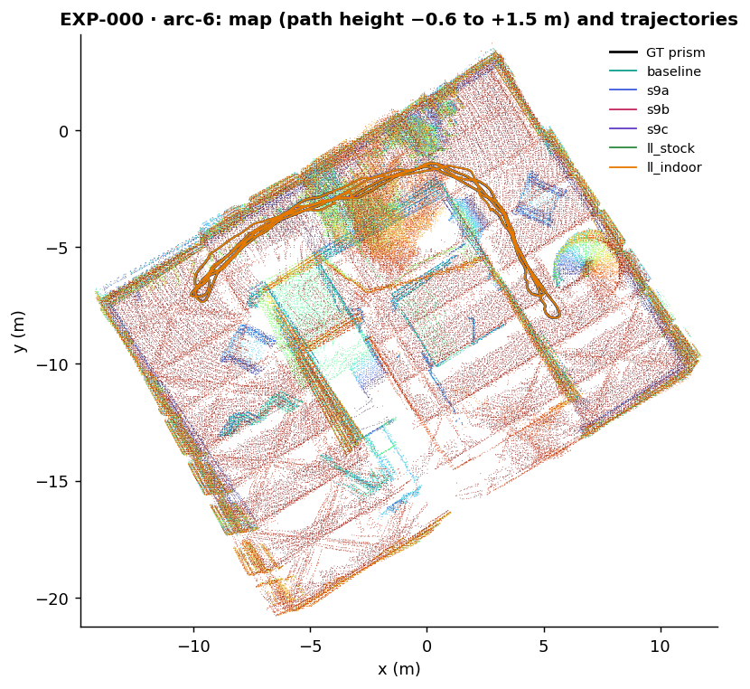
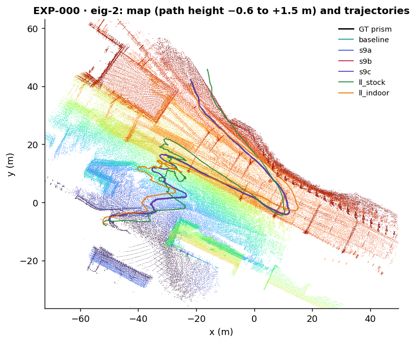
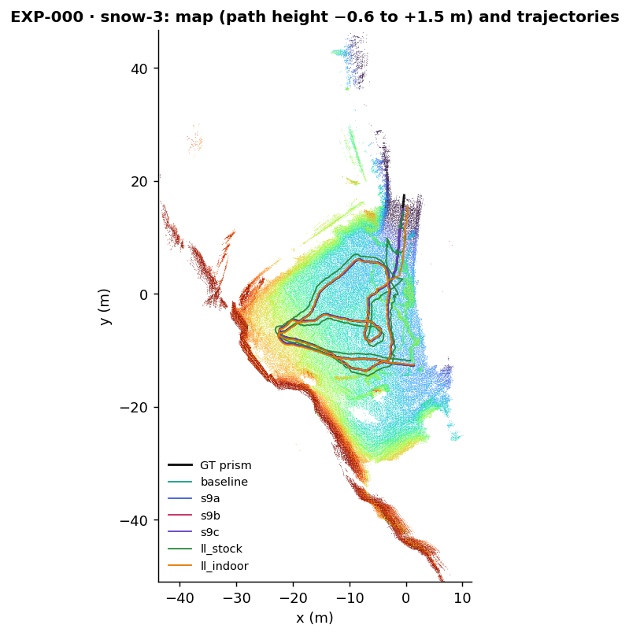

# EXP-000 — How large is run-to-run noise, and do the pre-repo baselines reproduce?

**TL;DR:** adopt: all six baselines reproduce their pre-repo ARC-6 ATE exactly (S8 0.8055 cm … lightning stock 1.6391 cm), every run has pose_coverage ≥ 0.9987, and 16 of 18 cells are bit-for-bit deterministic, so the noise floor is the 0.005 cm minimum in every cell except S9c on SNOW-3 (σ 0.0053 cm).

<!-- lvx:begin status -->
**Status:** ✅ concluded · verdict **🟢 adopt** · **Phase:** P0 (Foundation: baselines and noise floor) · **System:** `both` · **Depends on:** none
<!-- lvx:end status -->

## Question & hypothesis

<!-- lvx:begin hypothesis -->
| | |
|---|---|
| **Question** | How much does ATE vary between identical runs of each baseline on the dev missions, and do the pre-repo ARC-6 numbers reproduce inside the harness? |
| **Hypothesis** | Multithreaded map updates (OpenMP) make runs non-deterministic; the spread is small but not zero, and it sets the smallest effect any later experiment may claim. |
| **Prediction** | σ(ATE) per baseline and mission below 0.05 cm. On ARC-6 every mean is within 3σ of the pre-repo number (S8 0.8055, S9a 0.8916, S9b 0.8976, S9c 0.8989, lightning stock 1.6391, indoor 1.4066 cm; recomputed with lvx.evaluate from the pre-repo estimates). EIG-2 and SNOW-3 have no pre-repo numbers; there EXP-000 measures σ and the baselines only. Every run has pose_coverage ≥ 0.99. |
| **Falsified if** | any baseline misses its pre-repo ARC-6 number by more than 3σ, or any run has pose_coverage below 0.99. Either means the harness changed the system (wrong config, frame, time offset or core budget). |
| **Decision rule** | pass (verdict adopt = the harness is trusted) if every baseline reproduces on ARC-6 within 3σ and every run has pose_coverage ≥ 0.99; otherwise reject and fix the harness before any other experiment runs. The σ per (baseline, mission) from this experiment is the noise floor for all later ones (ADR-0004). |

<sub>The five fields in this table were locked when the experiment was approved (pre-registered in `spec.lock`) and cannot change.</sub>

> **Erratum (2026-10-12):** prediction says “S9c 0.8989”; it should say “S9c 0.8998”. Source: the pre-repo run log on the reference host gives S9c ARC-6 ate_rmse_cm 0.8998005 (recomputed with lvx.evaluate on 2026-10-08); the digits were swapped when the number was copied, and EXP-000 measured 0.8998. The frozen text is kept as approved.
<!-- lvx:end hypothesis -->

## Setup

<!-- lvx:begin setup -->
Each variant differs from the variant it is compared with in exactly one change. A variant marked – runs another system's stock config, and the variants of that system are compared with it.

| Variant | System | Compared with | What this variant changes |
|---|---|---|---|
| `baseline` | SE(3)-LVIO | – | the stock config `se3lvio_S8`, unchanged |
| `s9a` | SE(3)-LVIO | – | swap baseline config to S9a (adds Livox) |
| `s9b` | SE(3)-LVIO | – | swap baseline config to S9b (adds camera) |
| `s9c` | SE(3)-LVIO | – | swap baseline config to S9c (adds backend) |
| `ll_stock` | lightning-lm | – | swap baseline config to lightning-lm stock |
| `ll_indoor` | lightning-lm | – | swap baseline config to lightning-lm indoor grid |

- **Missions:** arc-6, eig-2, snow-3 (`{"set": "dev"}`)
- **Repeats:** 5 per variant × mission
- **Host:** `reference` (configs/hosts/reference.yaml)
- **Metrics:** primary `ate_rmse_cm`, secondary `ate_median_cm`, `ate_max_cm`, `ms_mean`, `ms_p95`, `rss_mb`, `pose_coverage`
- **Commits:** repo fb04f8769c · system 1325fed, 9bba0e4e06
<!-- lvx:end setup -->

## Results

<!-- lvx:begin results -->
Each cell shows `ate_rmse_cm` as the mean ± standard deviation over the repeats. Δ is the variant's mean minus the mean of the variant it is compared with, on the same mission. An effect counts only when |Δ| is larger than 2 × the run-to-run standard deviation σ of that system's stock config (σ from this experiment; never below 0.005 cm).

| Mission | Variant | ate_rmse_cm | Δ | Effect | ms p95 | runs ok / failed |
|---|---|---|---|---|---|---|
| arc-6 | `baseline` | 0.805 ± 0.000 |  |  | 36.1 | 5 / 0 |
| eig-2 | `baseline` | 2.489 ± 0.000 |  |  | 48.5 | 5 / 0 |
| snow-3 | `baseline` | 1.265 ± 0.000 |  |  | 50.3 | 5 / 0 |
| arc-6 | `s9a` | 0.892 ± 0.000 | +0.086 | ❔ no noise floor | 44.7 | 5 / 0 |
| eig-2 | `s9a` | 1.891 ± 0.000 | -0.598 | ❔ no noise floor | 63.1 | 5 / 0 |
| snow-3 | `s9a` | 1.362 ± 0.000 | +0.097 | ❔ no noise floor | 64.6 | 5 / 0 |
| arc-6 | `s9b` | 0.898 ± 0.000 | +0.092 | ❔ no noise floor | 67.3 | 5 / 0 |
| eig-2 | `s9b` | 2.081 ± 0.000 | -0.408 | ❔ no noise floor | 75.3 | 5 / 0 |
| snow-3 | `s9b` | 1.428 ± 0.000 | +0.163 | ❔ no noise floor | 78.1 | 5 / 0 |
| arc-6 | `s9c` | 0.900 ± 0.000 | +0.094 | ❔ no noise floor | 71.5 | 5 / 0 |
| eig-2 | `s9c` | 1.695 ± 0.001 | -0.795 | ❔ no noise floor | 111.7 | 5 / 0 |
| snow-3 | `s9c` | 1.364 ± 0.005 | +0.099 | ❔ no noise floor | 102.6 | 5 / 0 |
| arc-6 | `ll_stock` | 1.639 ± 0.000 | +0.834 | ❔ no noise floor | 32.2 | 5 / 0 |
| eig-2 | `ll_stock` | 464.587 ± 0.000 | +462.098 | ❔ no noise floor | 17.2 | 5 / 0 |
| snow-3 | `ll_stock` | 122.000 ± 0.000 | +120.735 | ❔ no noise floor | 19.7 | 5 / 0 |
| arc-6 | `ll_indoor` | 1.407 ± 0.000 | +0.601 | ❔ no noise floor | 35.8 | 5 / 0 |
| eig-2 | `ll_indoor` | 294.210 ± 0.000 | +291.720 | ❔ no noise floor | 58.4 | 5 / 0 |
| snow-3 | `ll_indoor` | 41.193 ± 0.000 | +39.928 | ❔ no noise floor | 67.9 | 5 / 0 |









### Maps

Map rebuilt from the baseline's repeat-1 estimate, all repeat-1 trajectories, in the GT frame (`lvx viewer`). Open a mission in the [interactive 3D viewer](https://munna-manoj.github.io/LVIO_exp/viewer/?exp=EXP-000) to orbit, hide the ceiling and toggle trajectories. Data: [GrandTour](https://huggingface.co/datasets/leggedrobotics/grand_tour_dataset) (MIT; Frey, Tuna et al., [arXiv:2602.18164](https://arxiv.org/abs/2602.18164)).

[](https://munna-manoj.github.io/LVIO_exp/viewer/?exp=EXP-000&mission=arc-6)

[](https://munna-manoj.github.io/LVIO_exp/viewer/?exp=EXP-000&mission=eig-2)

[](https://munna-manoj.github.io/LVIO_exp/viewer/?exp=EXP-000&mission=snow-3)
<!-- lvx:end results -->

- **Runs repeat exactly.** 16 of 18 cells have σ = 0.000 cm (Results table); their five `estimate.tum` files have the same md5. Only `s9c` on eig-2 (0.001 cm) and snow-3 (0.005 cm) vary, with 5 and 3 distinct estimates.
- **ARC-6 reproduces.** `baseline` 0.805, `s9a` 0.892, `s9b` 0.898, `s9c` 0.900, `ll_stock` 1.639, `ll_indoor` 1.407 cm (Results table, arc-6 rows): equal to the pre-repo numbers at the 4 decimals runs.csv keeps (see Threats for the S9c entry in the spec).
- **lightning-lm drifts off on the two field missions.** `ll_stock` 464.6 cm on eig-2 and 122.0 cm on snow-3; `ll_indoor` 294.2 and 41.2 cm (Results table). The top view shows it bending away from GT on eig-2 (traj_top.png) while still covering ≥ 99.87 % of the scans.
- **SE(3)-LVIO stays at 1.3–2.5 cm on every mission,** and the variants differ from S8 by −0.80 … +0.16 cm (Δ column); that is far above the floor, but EXP-000 makes no claim about them (later experiments do).
- **Time costs grow with sensors.** ms p95 36 → 45 → 67 → 71 on arc-6 from S8 to S9c, and the camera variants use 4.1–8.4 GB of RAM against 0.25–1.1 GB for the rest (pareto.png, `rss_mb` in summary.json).

## Discussion

The hypothesis expected OpenMP map updates to make runs differ. They don't. The input is replayed offline, and the parallel loops of the frontend apparently combine their results in a fixed order (we have not traced how), so each run computes the same floating-point numbers and `baseline`, `s9a`, `s9b` and both lightning-lm configs are deterministic on the 4-core budget. Only `s9c` adds the backend (plane BA and an iSAM2 pose graph), and it is the only source of noise we see: identical estimates on ARC-6, a few distinct ones on the longer field missions. A likely cause is the timing of when backend results are used, but we have not traced which call is responsible; EXP-014 (drift and loop closure) works on the backend and should confirm it.

For later experiments this means ([ADR-0004](../process/decisions/ADR-0004-noise-floor-decision-rule.md)): with σ = 0 the 0.005 cm floor applies, so any change of more than 2 × 0.005 = 0.01 cm counts as an effect on a deterministic cell. That is a strict bar on a number but a weak one on its meaning: a deterministic system can still move by 0.01 cm for a reason unrelated to the change (a different code path taken once). Later reports should therefore also say whether the change is consistent across missions, not only above the floor.

lightning-lm's large errors on eig-2 and snow-3 are a property of the baseline, not of the harness: the same harness reproduces it exactly on ARC-6. Neither of its configs was tuned for these missions, and glacier and snowfield scans offer few planes to match against. Whether a fair retune closes the gap is EXP-019's question. Background on the residual model is in [docs/explain](../explain/README.md).

## Verdict

**Adopt: the harness is trusted.** The frozen rule asks for every baseline within 3σ of its pre-repo ARC-6 number and every run with pose_coverage ≥ 0.99. All six ARC-6 means equal the pre-repo values recomputed with `lvx.evaluate` (gap 0.0000 cm at the 4 decimals runs.csv keeps, against a 3σ band of at least 0.015 cm with the ADR-0004 floor), and the lowest pose_coverage of the 90 runs is 0.9987 (`ll_*` on snow-3). The σ per (baseline, mission) in summary.json is now the noise floor for every later experiment.

## Threats to validity

- **The spec's S9c number had a typo.** The prediction lists S9c as 0.8989 cm; the pre-repo run log on the reference host says 0.8998005 cm, which is what EXP-000 measured. It is recorded as an erratum under the pre-registered fields (`lvx exp erratum`); the frozen text and `spec.lock` are unchanged, and `configs/baselines/se3lvio_S9c.yaml` now says 0.8998. Read literally, 0.8989 would still be inside the 3σ band (|0.8998 − 0.8989| = 0.0009 cm < 3 × 0.005 cm), so the verdict does not depend on it.
- **Reproduction means the same code on the same host.** The pre-repo runs and EXP-000 both ran on the reference host with the same system commits. This shows the harness does not change the system; it does not show the numbers carry over to another machine or core count (EXP-017 covers the core budget).
- **Three dev missions only.** Determinism and the noise floor were measured on arc-6, eig-2 and snow-3. A mission with more loop closures could make the backend noisier than snow-3.
- **lightning-lm's input was converted by us.** Its ROS 2 bags come from `offline_to_ros2bag.py`. ARC-6 reproduces, so the conversion is right there; a mission-specific problem (time offset, IMU rate) on eig-2 or snow-3 could inflate its error and would look the same in this table.
- **pose_coverage above 1.** `s9b` and `s9c` on snow-3 report 1.0004: 2319 estimate poses for 2318 scans in the IMU span. One extra pose at the start or end is harmless to the ≥ 0.99 rule but shows the count is not exactly one pose per scan for the camera variants.

## Failures

None failed or dirty: 90 of 90 runs `ok` (Results table).

One timing caveat: `baseline` arc-6 r3 (started 11:11:47 on 2026-10-08) overlapped an unpinned `lvx viewer` test of ours on the same host, from about 11:12 to 11:13. Because these runs are deterministic, every repeat does the same work on every scan, so r3 can be compared with the other four scan by scan (each repeat against the per-scan median of the other four, from the runs' `timing.csv`):

| Repeat | ms_mean | ms_p95 | ms_max | excess over the others, whole run | excess, last quarter |
|---|---|---|---|---|---|
| r1 | 27.41 | 36.48 | 54.4 | +0.70 ms | +0.25 ms |
| r2 | 26.94 | 33.21 | 55.8 | +0.15 ms | −0.07 ms |
| **r3** | 27.68 | 38.84 | 77.8 | +0.99 ms | **+2.65 ms** |
| r4 | 27.78 | 35.07 | 54.2 | +1.22 ms | +0.20 ms |
| r5 | 27.39 | 36.77 | 58.7 | +0.70 ms | +0.33 ms |

Over the whole run r3 is no slower than r4; the interference shows only in its last quarter (about 11:13:17 to 11:13:47), which is where its slow tail (p95, max) comes from. ATE is unaffected (same estimate md5 as the other repeats). The run is kept: runs are append-only, and a rerun to remove an inconvenient run is not allowed (CLAUDE.md law 5). Timing claims on this cell should use the median over repeats (`ms_mean` 27.41, `ms_p95` 36.48 in summary.json). Since then every other job on the host stays off cores 0–3.

## Reproduce

<!-- lvx:begin reproduce -->
```bash
lvx run EXP-000 --host reference     # every variant × mission × repeat, on the reference host
lvx eval EXP-000                  # runs.csv + summary.json
lvx figures EXP-000
lvx viewer EXP-000                # on the host: map + trajectories for the 3D viewer
lvx report EXP-000
```

What `lvx run` executed for each variant (repeat 1; all runs are in `results/manifests/`):

**baseline** (from `systems/se3-lvio`; `$OUT` = this run's directory: <run_root>/<EXP>/<variant>/<mission>/r<k>, `$GRANDTOUR` = dataset `grandtour` (configs/datasets.yaml), `$MISSION` = the mission folder inside $GRANDTOUR, `$IMAGE` = the system's container image (systems/systems.yaml; local tag in lvx.local.yaml), `$PATH` = the caller's PATH, after the machine's own tool folders (lvx.local.yaml `path`, e.g. a docker shim)):

```bash
DATA="$GRANDTOUR" CPUSET=0-3 IMAGE="$IMAGE" bash scripts/run_se3lio.sh arc-6 --tag EXP-000-baseline__arc-6__r1 --lio-only
```

**ll_indoor** (from `.`; `$OUT` = this run's directory: <run_root>/<EXP>/<variant>/<mission>/r<k>, `$GRANDTOUR` = dataset `grandtour` (configs/datasets.yaml), `$MISSION` = the mission folder inside $GRANDTOUR, `$IMAGE` = the system's container image (systems/systems.yaml; local tag in lvx.local.yaml), `$PATH` = the caller's PATH, after the machine's own tool folders (lvx.local.yaml `path`, e.g. a docker shim), `$LIGHTNING_WS` = the lightning-lm colcon workspace built by scripts/build_lightning.sh, `$BAG` = the mission as a ROS 2 bag: <run_root>/derived/lightning-bags/<mission>):

```bash
podman run --rm -v "$LIGHTNING_WS":/ws -v "$BAG":/bag:ro -v "$OUT":/out -w /ws/src/lightning-lm "$IMAGE" bash -c 'source /opt/ros/humble/setup.bash && source /ws/install/setup.bash && taskset -c 0-3 ./bin/run_lio_tum --input_bag /bag --config /out/config.yaml --output /out/arc-6_imu.tum --timing /out/timing.csv --log_dir /out' > "$OUT/run.log" 2>&1 && python3 systems/se3-lvio/tools/to_prism.py "$MISSION/comfort_offline/calib.json" "$OUT/arc-6_imu.tum" "$OUT/estimate.tum"
```

**ll_stock** (from `.`; `$OUT` = this run's directory: <run_root>/<EXP>/<variant>/<mission>/r<k>, `$GRANDTOUR` = dataset `grandtour` (configs/datasets.yaml), `$MISSION` = the mission folder inside $GRANDTOUR, `$IMAGE` = the system's container image (systems/systems.yaml; local tag in lvx.local.yaml), `$PATH` = the caller's PATH, after the machine's own tool folders (lvx.local.yaml `path`, e.g. a docker shim), `$LIGHTNING_WS` = the lightning-lm colcon workspace built by scripts/build_lightning.sh, `$BAG` = the mission as a ROS 2 bag: <run_root>/derived/lightning-bags/<mission>):

```bash
podman run --rm -v "$LIGHTNING_WS":/ws -v "$BAG":/bag:ro -v "$OUT":/out -w /ws/src/lightning-lm "$IMAGE" bash -c 'source /opt/ros/humble/setup.bash && source /ws/install/setup.bash && taskset -c 0-3 ./bin/run_lio_tum --input_bag /bag --config /out/config.yaml --output /out/arc-6_imu.tum --timing /out/timing.csv --log_dir /out' > "$OUT/run.log" 2>&1 && python3 systems/se3-lvio/tools/to_prism.py "$MISSION/comfort_offline/calib.json" "$OUT/arc-6_imu.tum" "$OUT/estimate.tum"
```

**s9a** (from `systems/se3-lvio`; `$OUT` = this run's directory: <run_root>/<EXP>/<variant>/<mission>/r<k>, `$GRANDTOUR` = dataset `grandtour` (configs/datasets.yaml), `$MISSION` = the mission folder inside $GRANDTOUR, `$IMAGE` = the system's container image (systems/systems.yaml; local tag in lvx.local.yaml), `$PATH` = the caller's PATH, after the machine's own tool folders (lvx.local.yaml `path`, e.g. a docker shim)):

```bash
DATA="$GRANDTOUR" CPUSET=0-3 IMAGE="$IMAGE" bash scripts/run_se3lio.sh arc-6 --tag EXP-000-s9a__arc-6__r1 --lio-only --lidar multi
```

**s9b** (from `systems/se3-lvio`; `$OUT` = this run's directory: <run_root>/<EXP>/<variant>/<mission>/r<k>, `$GRANDTOUR` = dataset `grandtour` (configs/datasets.yaml), `$MISSION` = the mission folder inside $GRANDTOUR, `$IMAGE` = the system's container image (systems/systems.yaml; local tag in lvx.local.yaml), `$PATH` = the caller's PATH, after the machine's own tool folders (lvx.local.yaml `path`, e.g. a docker shim)):

```bash
DATA="$GRANDTOUR" CPUSET=0-3 IMAGE="$IMAGE" bash scripts/run_se3lio.sh arc-6 --tag EXP-000-s9b__arc-6__r1 --lidar multi
```

**s9c** (from `systems/se3-lvio`; `$OUT` = this run's directory: <run_root>/<EXP>/<variant>/<mission>/r<k>, `$GRANDTOUR` = dataset `grandtour` (configs/datasets.yaml), `$MISSION` = the mission folder inside $GRANDTOUR, `$IMAGE` = the system's container image (systems/systems.yaml; local tag in lvx.local.yaml), `$PATH` = the caller's PATH, after the machine's own tool folders (lvx.local.yaml `path`, e.g. a docker shim)):

```bash
DATA="$GRANDTOUR" CPUSET=0-3 IMAGE="$IMAGE" bash scripts/run_se3lio.sh arc-6 --tag EXP-000-s9c__arc-6__r1 --lidar multi --backend
```
<!-- lvx:end reproduce -->
