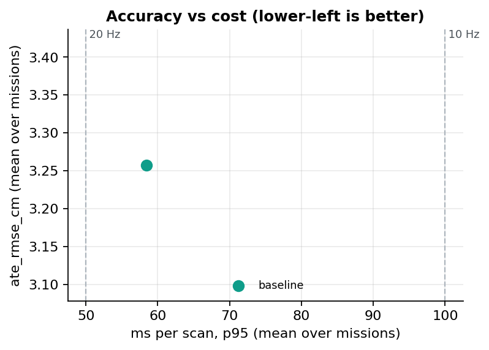
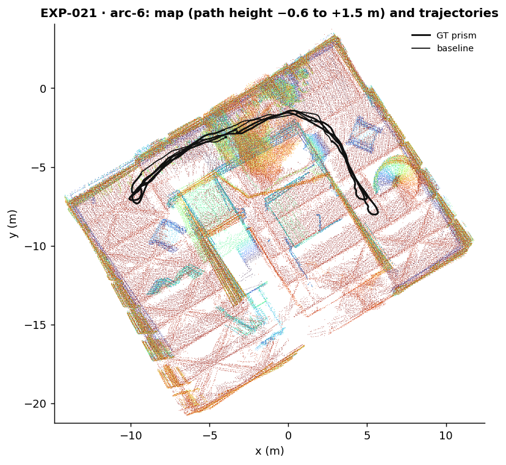
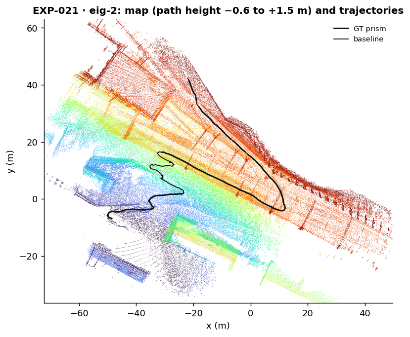
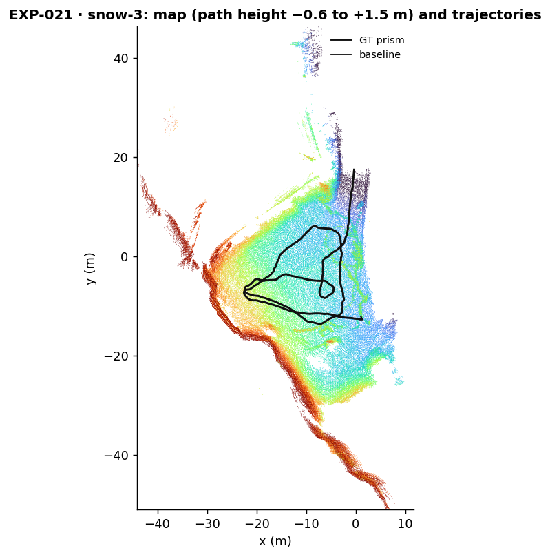

# EXP-021 — How large is GenZ-LIO's run-to-run noise, and does the harness run it correctly?

**TL;DR:** adopt, but superseded by EXP-022. All 15 GenZ-LIO runs are `ok`, and the five repeats of each mission are bit-for-bit identical (σ = 0). Every run keeps at least 99.94 % of the scans. GenZ-LIO's ATE is 1.382 cm on ARC-6 (the limit was 3 cm), 2.506 cm on EIG-2 and 5.884 cm on SNOW-3. These runs lacked each mission's IMU time offset, so the numbers are not comparable with EXP-000's.

> [!WARNING]
> **Superseded by [EXP-022](EXP-022-genz-lio-baseline-with-imu-offset.md) (2026-10-12).** After this experiment was concluded we found that its runs lacked the per-mission IMU time offset (`configs/missions.yaml` `imu_dt`, −4.8 to −6.5 ms), which the protocol gives every system (CLAUDE.md §3). The verdict below stands as recorded, but these numbers are not comparable with EXP-000's. GenZ-LIO's baseline and noise floor come from EXP-022.

<!-- lvx:begin status -->
**Status:** ✅ concluded · verdict **🟢 adopt** · **Phase:** P0 (Foundation: baselines and noise floor) · **System:** `genz-lio` · **Depends on:** EXP-000
<!-- lvx:end status -->

## Question & hypothesis

<!-- lvx:begin hypothesis -->
**Terms used on this page**

| Term | Meaning |
|---|---|
| **ATE** | Absolute trajectory error: the root-mean-square distance between the estimated trajectory and the ground-truth trajectory, in centimetres, after the two are aligned. Lower is better. |
| **scan time (ms_p95)** | The time a system needs to process one LiDAR scan, in milliseconds. `ms_p95` is the 95th percentile over a mission: 95 % of the scans take less than this. |
| **noise floor** | The smallest ATE difference that counts as a real effect: 2 × σ, where σ is the standard deviation of ATE between identical runs of that system's stock config (EXP-000 for SE(3)-LVIO and lightning-lm, EXP-022 for GenZ-LIO). It is never less than 0.01 cm. |
| **variant** | One configuration that is run. Each variant differs from the variant it is compared with in exactly one change. |
| **dev missions** | The three missions used to decide experiments: ARC-6 (indoor, with smoke), EIG-2 (a glacier climb, outdoor) and SNOW-3 (a snow field, outdoor). The test missions are kept for final reports. |
| **`baseline` (genz_stock)** | GenZ-LIO's stock config: upstream's Hesai settings, with only the sensor calibration and the 4-core limit set. |
| **IMU time offset** | The delay between the IMU clock and the LiDAR clock, fitted once per mission (configs/missions.yaml `imu_dt`). The protocol applies it to every system. |
| **pose_coverage** | The share of the scans in the IMU's time span for which the system produced a pose. 1.0 means one pose per scan. |
| **deterministic** | Identical runs give bit-for-bit identical trajectories (σ = 0). |

**Which systems take part**

| System | Takes part | How, or why not |
|---|---|---|
| GenZ-LIO | yes | Its stock config, 5 repeats per mission. |
| SE(3)-LVIO | no | Its noise floor comes from EXP-000; its numbers are quoted for comparison. |
| lightning-lm | no | Its noise floor comes from EXP-000; its numbers are quoted for comparison. |

| | |
|---|---|
| **Question** | How much does ATE vary between identical runs of GenZ-LIO stock on the dev missions, and does the harness run it without dropping scans or mis-placing the LiDAR? |
| **Hypothesis** | GenZ-LIO's worker threads (correspondence search and map updates, runtime.max_threads 4) combine their results in a fixed order on an offline replay, as SE(3)-LVIO's frontend does (EXP-000), so its runs are deterministic or nearly so. With upstream's Hesai template and the GrandTour extrinsic it tracks every dev mission at centimetre level. |
| **Prediction** | σ(ATE) per mission below 0.05 cm. Every run has pose_coverage ≥ 0.99. ATE on ARC-6 below 3 cm (one scratch smoke run while integrating gave 1.38 cm; it informed this bound and is not a result). EIG-2 and SNOW-3 are measured only; no bound is predicted there. |
| **Falsified if** | any run has pose_coverage below 0.99, any run fails, or ARC-6 ATE is 3 cm or more. Each means the harness or the config is wrong for GenZ-LIO (frame, extrinsic, timestamps, or core budget). |
| **Decision rule** | pass (verdict adopt = GenZ-LIO runs correctly in the harness) if all 15 runs are ok with pose_coverage ≥ 0.99 and the ARC-6 mean ATE is below 3 cm; otherwise reject and fix the runner or config before any experiment uses GenZ-LIO. The σ per mission from this experiment is GenZ-LIO's noise floor for all later experiments (ADR-0004, ADR-0012). |

<sub>The five fields in this table were locked when the experiment was approved (pre-registered in `spec.lock`) and cannot change.</sub>
<!-- lvx:end hypothesis -->

## Setup

<!-- lvx:begin setup -->
Each variant differs from the variant it is compared with in exactly one change. A variant marked – runs another system's stock config, and the variants of that system are compared with it.

| Variant | System | Compared with | What this variant changes |
|---|---|---|---|
| `baseline` | GenZ-LIO | – | the stock config `genz_stock`, unchanged |

- **Missions:** arc-6, eig-2, snow-3 (`{"set": "dev"}`)
- **Repeats:** 5 per variant × mission
- **Host:** `reference` (configs/hosts/reference.yaml)
- **Metrics:** primary `ate_rmse_cm`, secondary `ate_median_cm`, `ate_max_cm`, `ms_mean`, `ms_p95`, `rss_mb`, `pose_coverage`
- **Commits:** repo fbfe8690af · system 82328f5937
<!-- lvx:end setup -->

## Results

<!-- lvx:begin results -->
Each cell shows `ate_rmse_cm` as the mean ± standard deviation over the repeats. Δ is the variant's mean minus the mean of the variant it is compared with, on the same mission. An effect counts only when |Δ| is larger than 2 × the run-to-run standard deviation σ of that system's stock config (σ from this experiment; never below 0.005 cm).

| Mission | Variant | ate_rmse_cm | Δ | Effect | ms p95 | runs ok / failed |
|---|---|---|---|---|---|---|
| arc-6 | `baseline` | 1.382 ± 0.000 |  |  | 37.8 | 5 / 0 |
| eig-2 | `baseline` | 2.506 ± 0.000 |  |  | 70.6 | 5 / 0 |
| snow-3 | `baseline` | 5.884 ± 0.000 |  |  | 66.7 | 5 / 0 |



### Maps

Map rebuilt from the baseline's repeat-1 estimate, all repeat-1 trajectories, in the GT frame (`lvx viewer`). Open a mission in the [interactive 3D viewer](https://munna-manoj.github.io/LVIO_exp/viewer/?exp=EXP-021) to orbit, hide the ceiling and toggle trajectories. Data: [GrandTour](https://huggingface.co/datasets/leggedrobotics/grand_tour_dataset) (MIT; Frey, Tuna et al., [arXiv:2602.18164](https://arxiv.org/abs/2602.18164)).

[](https://munna-manoj.github.io/LVIO_exp/viewer/?exp=EXP-021&mission=arc-6)

[](https://munna-manoj.github.io/LVIO_exp/viewer/?exp=EXP-021&mission=eig-2)

[](https://munna-manoj.github.io/LVIO_exp/viewer/?exp=EXP-021&mission=snow-3)
<!-- lvx:end results -->

- **Identical runs give identical results.** σ is 0.000 cm on all three missions (Results table), and the five `estimate.tum` files of each mission have the same md5.
- **ARC-6 is at 1.382 cm, inside the pre-registered 3 cm limit.** For comparison, on the same mission EXP-000 measured SE(3)-LVIO S8 at 0.805 cm and lightning-lm at 1.407 cm (indoor config) and 1.639 cm (stock config).
- **GenZ-LIO keeps track on both field missions.** On EIG-2 it reaches 2.506 cm, close to S8's 2.489 cm, where lightning-lm lost track (294 to 465 cm in EXP-000). On SNOW-3 it reaches 5.884 cm, about 4.7 × S8's 1.265 cm (Results table; EXP-000 for the other systems).
- **Coverage.** Every run keeps at least 99.94 % of the scans in the IMU's time span. Each run skips exactly one scan at the start, which GenZ-LIO reports as not valid yet (the runner's `summary.json`: `skipped: 1`). The first valid scan initialises the filter (0 ms in `timing.csv`).
- **Cost on 4 cores.** ms_p95 is 37.8 ms on ARC-6, 70.6 ms on EIG-2 and 66.7 ms on SNOW-3; memory is 0.46, 2.6 and 1.4 GB (pareto.png, `summary.json`). On ARC-6, GenZ-LIO's time per scan is close to S8's (ms_mean 32.0 against 27.4 ms in EXP-000).

## Discussion

GenZ-LIO is deterministic for the same reason as SE(3)-LVIO in EXP-000. The input is replayed from files in the same order every time, and GenZ-LIO's 4 worker threads evidently combine their results in a fixed order; we have not traced how.

GenZ-LIO keeps track on the glacier (EIG-2), where lightning-lm lost it. The GenZ-LIO paper motivates its two main ideas with such scenes. One is a point-to-point residual for open spaces with few planes. The other is a point budget that adapts the voxel size to the size of the scene. Which idea carries GenZ-LIO on EIG-2 is a question for the ablations (EXP-023 and EXP-024), not for this experiment.

Why GenZ-LIO is 4.7 × worse than SE(3)-LVIO on SNOW-3 is also open. Candidates are SE(3)-LVIO's coupled SE(3) pose update (EXP-009) and its planes with uncertainty (EXP-020). Background: [SE(3) vs SO(3)×R³](../explain/se3-vs-so3xr3.md).

## Verdict

**Adopt, as recorded: GenZ-LIO runs in the harness.** The frozen rule asks for all 15 runs `ok`, with pose_coverage ≥ 0.99, and an ARC-6 mean ATE below 3 cm. All 15 runs are `ok`, the lowest pose_coverage is 0.9994, and ARC-6 is 1.382 cm.

After this verdict, we found that the runs lacked the IMU time offset (see the warning above and Threats to validity). EXP-022 repeats the experiment with the offset, and GenZ-LIO's noise floor comes from EXP-022, not from this experiment.

## Threats to validity

- **The 3 cm limit was informed by a trial run.** One trial run during the integration gave 1.382 cm on ARC-6, and the spec says so. The limit was set at about twice that, so the pass is not in doubt, but it is not a blind prediction. The result equals the trial run exactly, as determinism implies.
- **Stock, not tuned.** `genz_stock` is upstream's Hesai config with only the sensor calibration and the 4-core limit set. Upstream tuned per sequence for its own benchmarks. Tuning on the dev missions may narrow the SNOW-3 gap; that is EXP-026.
- **Our runner, not upstream's command-line tool.** Our runner reads the mission files itself.
  - It pairs scans with IMU samples using upstream's own `_ScanBuffer`.
  - It passes the Hesai per-point times relative to the scan start, which is upstream's convention for this LiDAR.
  - It reorders the IMU columns to upstream's order.
  - A wrong convention would bend the trajectories. ARC-6 at 1.4 cm and EIG-2 at 2.5 cm make that unlikely, but do not prove each step.
- **One LiDAR.** GenZ-LIO uses the Hesai only, as SE(3)-LVIO S8 does. S9a also uses the Livox, so comparisons across systems should pair configs with the same sensors.
- **Three dev missions and one host,** as in EXP-000.
- **The protocol was not followed (found after concluding).** The runner read the IMU file without each mission's IMU time offset (`imu_dt`, −4.8 to −6.5 ms), which SE(3)-LVIO's runner and lightning-lm's bags apply. An IMU–LiDAR misalignment of a few milliseconds changes the motion prediction and the scan's distortion correction in fast turns. The numbers here may therefore differ from GenZ-LIO's numbers under the protocol. The runner was fixed in the fork (commit 0936d34) and in `lvx/runner.py`, and EXP-022 repeats the experiment.

## Failures

None: 15 of 15 runs are `ok`, and none ran from uncommitted code (repo commit fbfe869, GenZ-LIO commit 82328f5). None of our other jobs ran on the host during the run.

## Reproduce

<!-- lvx:begin reproduce -->
```bash
lvx run EXP-021 --host reference     # every variant × mission × repeat, on the reference host
lvx eval EXP-021                  # runs.csv + summary.json
lvx figures EXP-021
lvx viewer EXP-021                # on the host: map + trajectories for the 3D viewer
lvx report EXP-021
```

What `lvx run` executed for each variant (repeat 1; all runs are in `results/manifests/`):

**baseline** (from `.`; `$OUT` = this run's directory: <run_root>/<EXP>/<variant>/<mission>/r<k>, `$GRANDTOUR` = dataset `grandtour` (configs/datasets.yaml), `$MISSION` = the mission folder inside $GRANDTOUR, `$IMAGE` = the system's container image (systems/systems.yaml; local tag in lvx.local.yaml), `$PATH` = the caller's PATH, after the machine's own tool folders (lvx.local.yaml `path`, e.g. a docker shim)):

```bash
podman run --rm -v "$MISSION":/mission:ro -v "$OUT":/out "$IMAGE" bash -c 'taskset -c 0-3 python3 lvio_exp/run_comfort.py /mission/comfort_offline /out/config.yaml /out --name arc-6' > "$OUT/run.log" 2>&1 && python3 systems/se3-lvio/tools/to_prism.py "$MISSION/comfort_offline/calib.json" "$OUT/arc-6_imu.tum" "$OUT/estimate.tum"
```
<!-- lvx:end reproduce -->
