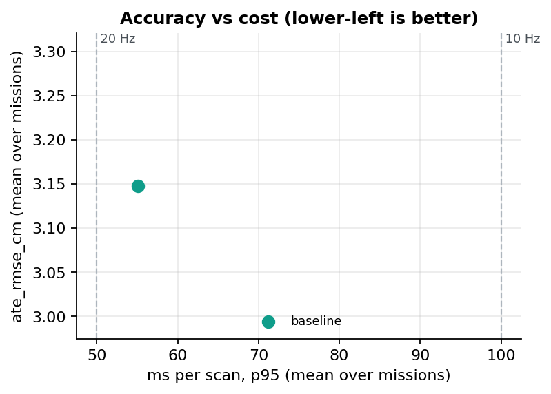
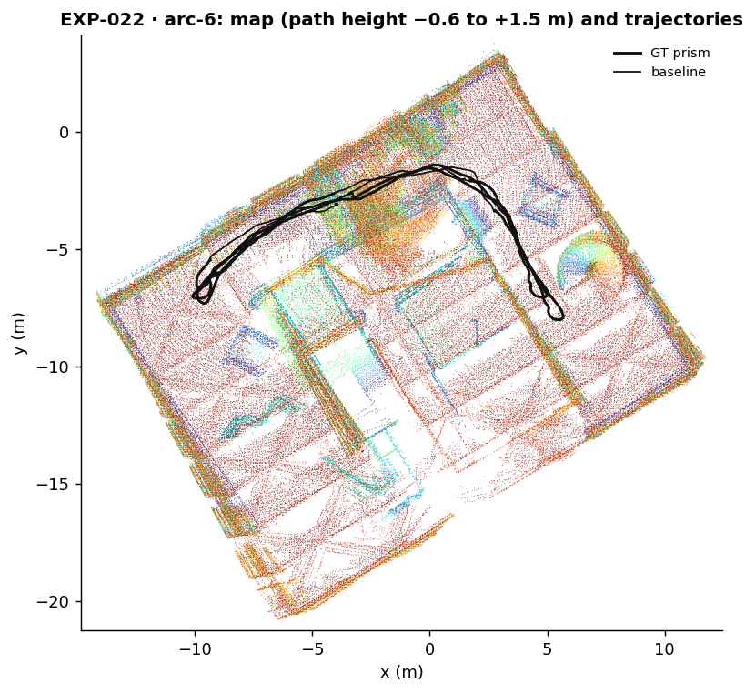
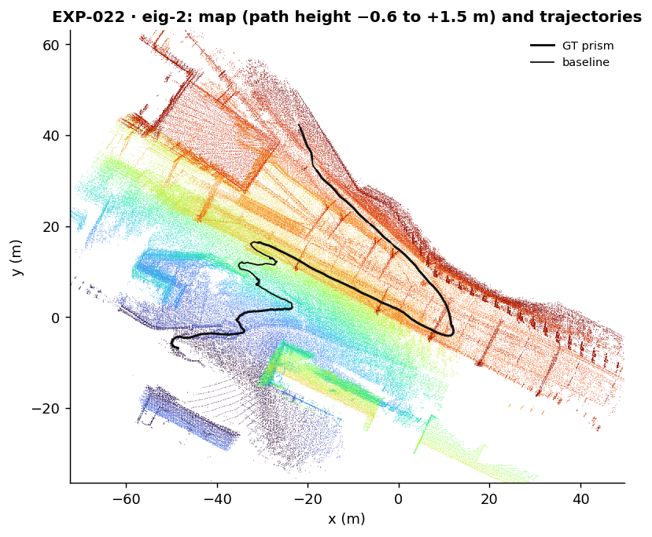
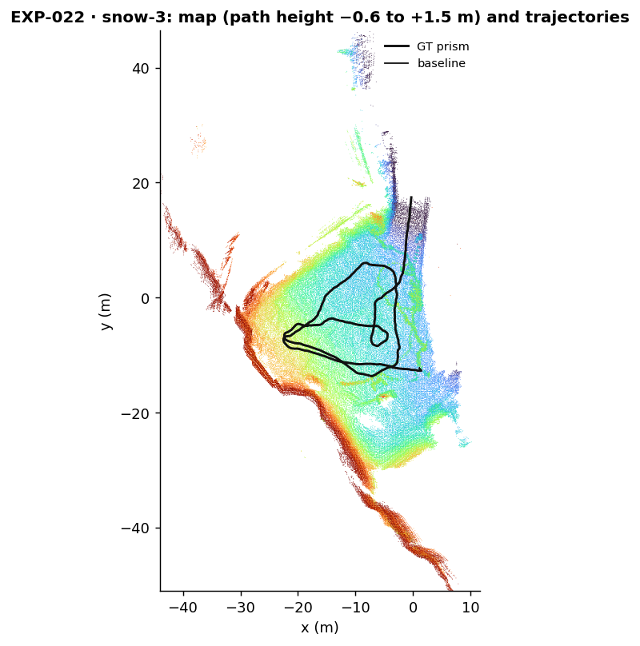

# EXP-022 — How large is GenZ-LIO's run-to-run noise, with the protocol's IMU time offset?

**TL;DR:** adopt: with the per-mission IMU time offset applied, all 15 GenZ-LIO runs are ok, bit-for-bit deterministic (σ = 0, so its noise floor is the 0.005 cm minimum), cover ≥ 0.9991 of the scans, and score 1.501 cm on ARC-6 (bound 3 cm), 2.341 cm on EIG-2 and 5.602 cm on SNOW-3. This replaces [EXP-021](EXP-021-genz-lio-baseline-and-noise-floor.md), which ran without the offset.

<!-- lvx:begin status -->
**Status:** ✅ concluded · verdict **🟢 adopt** · **Phase:** P0 (Foundation: baselines and noise floor) · **System:** `genz-lio` · **Depends on:** EXP-000
<!-- lvx:end status -->

## Question & hypothesis

<!-- lvx:begin hypothesis -->
| | |
|---|---|
| **Question** | How much does ATE vary between identical runs of GenZ-LIO stock on the dev missions, and does the harness run it without dropping scans or mis-placing the LiDAR? |
| **Hypothesis** | GenZ-LIO's worker threads (correspondence search and map updates, runtime.max_threads 4) combine their results in a fixed order on an offline replay, as SE(3)-LVIO's frontend does (EXP-000), so its runs are deterministic or nearly so. With upstream's Hesai template and the GrandTour extrinsic it tracks every dev mission at centimetre level. |
| **Prediction** | σ(ATE) per mission below 0.05 cm. Every run has pose_coverage ≥ 0.99. ATE on ARC-6 below 3 cm. EXP-021 ran the same config without the IMU offset and got 1.382 (arc-6), 2.506 (eig-2) and 5.884 cm (snow-3); with the offset we expect each within ±20 % of those, since the offset is 5-6.5 ms and the IMU prior is only one input to each scan's update. |
| **Falsified if** | any run has pose_coverage below 0.99, any run fails, or ARC-6 ATE is 3 cm or more. Each means the harness or the config is wrong for GenZ-LIO (frame, extrinsic, timestamps, or core budget). |
| **Decision rule** | pass (verdict adopt = GenZ-LIO runs correctly in the harness, under the full protocol) if all 15 runs are ok with pose_coverage ≥ 0.99 and the ARC-6 mean ATE is below 3 cm; otherwise reject and fix the runner or config before any experiment uses GenZ-LIO. The σ per mission from this experiment is GenZ-LIO's noise floor for all later experiments (ADR-0004, ADR-0012). |

<sub>Fields above are pre-registered (`spec.lock`).</sub>
<!-- lvx:end hypothesis -->

## Setup

<!-- lvx:begin setup -->
| Variant | The one change |
|---|---|
| `baseline` | genz_stock as is |

- **Missions:** arc-6, eig-2, snow-3 (`{"set": "dev"}`)
- **Repeats:** 5 per variant × mission
- **Host:** `reference` (configs/hosts/reference.yaml)
- **Metrics:** primary `ate_rmse_cm`, secondary `ate_median_cm`, `ate_max_cm`, `ms_mean`, `ms_p95`, `rss_mb`, `pose_coverage`
- **Commits:** repo 3417882e7c · system 0936d34b61
<!-- lvx:end setup -->

## Results

<!-- lvx:begin results -->
Primary metric `ate_rmse_cm`: mean ± std over repeats. Δ is against `baseline` on the same mission; the effect is called only when |Δ| > 2σ of run-to-run noise (σ from this experiment).

| Mission | Variant | ate_rmse_cm | Δ | Effect | ms p95 | runs ok / failed |
|---|---|---|---|---|---|---|
| arc-6 | `baseline` | 1.501 ± 0.000 |  |  | 38.2 | 5 / 0 |
| eig-2 | `baseline` | 2.341 ± 0.000 |  |  | 65.7 | 5 / 0 |
| snow-3 | `baseline` | 5.602 ± 0.000 |  |  | 61.4 | 5 / 0 |



### Maps

Map rebuilt from the baseline's repeat-1 estimate, all repeat-1 trajectories, in the GT frame (`lvx viewer`). Open a mission in the [interactive 3D viewer](https://munna-manoj.github.io/LVIO_exp/viewer/?exp=EXP-022) to orbit, hide the ceiling and toggle trajectories. Data: [GrandTour](https://huggingface.co/datasets/leggedrobotics/grand_tour_dataset) (MIT; Frey, Tuna et al., [arXiv:2602.18164](https://arxiv.org/abs/2602.18164)).

[](https://munna-manoj.github.io/LVIO_exp/viewer/?exp=EXP-022&mission=arc-6)

[](https://munna-manoj.github.io/LVIO_exp/viewer/?exp=EXP-022&mission=eig-2)

[](https://munna-manoj.github.io/LVIO_exp/viewer/?exp=EXP-022&mission=snow-3)
<!-- lvx:end results -->

- **Runs repeat exactly.** σ = 0.000 cm on all three missions (Results table); the five `estimate.tum` files of each mission have the same md5.
- **ARC-6 at 1.501 cm,** inside the pre-registered 3 cm bound. For orientation, EXP-000 measured SE(3)-LVIO S8 at 0.805 cm and lightning-lm at 1.407 (indoor) and 1.639 cm (stock) on the same mission.
- **The offset moves each mission by under 9 %, both ways.** Against EXP-021 (same config, no offset): ARC-6 1.382 → 1.501 cm (+8.6 %), EIG-2 2.506 → 2.341 cm (−6.6 %), SNOW-3 5.884 → 5.602 cm (−4.8 %). All three are inside the ±20 % the prediction expected.
- **Coverage.** The lowest is 0.9991 (EIG-2), and every run keeps ≥ 0.99 of the scans. As in EXP-021, each run skips exactly one scan at the start, before the filter has initialised (runner `summary.json`: `skipped: 1`). The frame count is also unchanged (3489 on ARC-6).
- **Cost on 4 cores.** ms p95 38.2 (arc-6), 65.7 (eig-2), 61.4 (snow-3); ms_mean 32.2, 46.2, 51.9; RSS 0.49, 2.5 and 1.4 GB (pareto.png, `runs.csv`). These are within 8 % of EXP-021's timings, as expected: the offset changes when the IMU samples fall, not how much work each scan does.

## Discussion

Determinism is as in EXP-000 and EXP-021: the input is replayed offline in the same order every time, and GenZ-LIO's 4 worker threads evidently combine their results in a fixed order. GenZ-LIO variants are therefore judged against the 0.005 cm floor (ADR-0004, ADR-0012). An effect of more than 0.01 cm counts, so later reports should also ask whether an effect is consistent across missions.

The offset shifts every IMU stamp by 4.8–6.5 ms against the LiDAR. That changes the IMU samples used to predict each scan's motion and to deskew its points. The scan-to-map update then corrects most of the prediction error, which is why the change in ATE is a few millimetres and not centimetres. The sign is not consistent: ARC-6 got worse while the two field missions got better, so the offset is not simply "right" for GenZ-LIO on every mission. It is the protocol, applied the same way to every system (CLAUDE.md §3), and that is what makes these numbers comparable with EXP-000. The SNOW-3 gap to SE(3)-LVIO S8 (5.602 vs 1.265 cm, 4.4 ×) remains a question for the ablations (EXP-009 for the state; background in [SE(3) vs SO(3)×R³](../explain/se3-vs-so3xr3.md)).

## Verdict

**Adopt: GenZ-LIO runs correctly in the harness, under the full protocol.** The frozen rule asks for all 15 runs ok with pose_coverage ≥ 0.99 and an ARC-6 mean ATE below 3 cm. All 15 are ok, the lowest coverage is 0.9991, and ARC-6 is 1.501 cm. The σ per mission (0 everywhere, so the 0.005 cm floor) is GenZ-LIO's noise floor from now on. `lvx eval` takes it from this experiment for every `genz_stock` baseline (`noise_floor` in summary.json), and EXP-021's floor is not used.

## Threats to validity

- **The bounds were informed by earlier runs.** The 3 cm bound and the ±20 % band were set from EXP-021's numbers, and the spec says so. The pass is not in doubt (ARC-6 is at half the bound), but it is not a blind prediction.
- **Stock, not tuned.** `genz_stock` is upstream's Hesai template with only platform keys changed. Tuning on dev may narrow the SNOW-3 gap; that is a fairness experiment (EXP-026, like EXP-019 for lightning-lm), not this one.
- **Our runner, not upstream's CLI.** As in EXP-021: upstream's own `_ScanBuffer` pairs scans and IMU, Hesai per-point times are passed relative to the scan start, and the IMU columns are reordered. The offset is applied by shifting the integer nanosecond stamps, as the lightning-lm bag converter does. The first shifted IMU stamp of ARC-6 equals the bag's to the nanosecond.
- **One LiDAR** (the Hesai), like S8. S9a also uses the Livox; cross-system comparisons should pair like with like.
- **Three dev missions, one host,** as in EXP-000.

## Failures

None: 15 of 15 runs `ok`, none dirty (repo 3417882, system 0936d34, both clean). The image was rebuilt from 0936d34 before the run; each run's `summary.json` records `imu_dt` (e.g. −0.0065 on ARC-6). None of our other jobs ran on the host during the run.

## Reproduce

<!-- lvx:begin reproduce -->
```bash
lvx run EXP-022 --host reference     # every variant × mission × repeat, on the reference host
lvx eval EXP-022                  # runs.csv + summary.json
lvx figures EXP-022
lvx viewer EXP-022                # on the host: map + trajectories for the 3D viewer
lvx report EXP-022
```

What `lvx run` executed for each variant (repeat 1; all runs are in `results/manifests/`):

**baseline** (from `.`; `$OUT` = this run's directory: <run_root>/<EXP>/<variant>/<mission>/r<k>, `$GRANDTOUR` = dataset `grandtour` (configs/datasets.yaml), `$MISSION` = the mission folder inside $GRANDTOUR, `$IMAGE` = the system's container image (systems/systems.yaml; local tag in lvx.local.yaml), `$PATH` = the caller's PATH, after the machine's own tool folders (lvx.local.yaml `path`, e.g. a docker shim)):

```bash
podman run --rm -v "$MISSION":/mission:ro -v "$OUT":/out "$IMAGE" bash -c 'taskset -c 0-3 python3 lvio_exp/run_comfort.py /mission/comfort_offline /out/config.yaml /out --name arc-6 --imu-dt -0.0065' > "$OUT/run.log" 2>&1 && python3 systems/se3-lvio/tools/to_prism.py "$MISSION/comfort_offline/calib.json" "$OUT/arc-6_imu.tum" "$OUT/estimate.tum"
```
<!-- lvx:end reproduce -->
